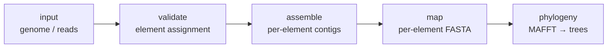

<div align="center">

<picture>
  <source media="(prefers-color-scheme: dark)" srcset="docs/figures/banner-dark.svg">
  
</picture>

**Conserved Non-coding Element eXplorer**

<sub>Fast, reproducible CNE discovery from whole genomes or sequencing reads</sub>

<br>

[](https://github.com/zoomlion/CNEX/tags)
[](LICENSE)
[]()
[]()

<br>

[**Install**](#install) · [Quick start](#quick-start) · [How it works](#how-it-works) ·
[Commands](#commands) · [Reads mode](#reads-mode) · [Phylogeny](#phylogeny) ·
[Docs](docs/) · [Benchmark](benchmark/README.md)

</div>

---

<table>
<tr>
<td align="center" width="33%">

**k-mer primed**

Element-specific confident k-mers steer the de Bruijn graph, so contigs stay on target.

</td>
<td align="center" width="33%">

**One pipeline, two inputs**

Multi-species genome FASTA or paired-end reads — same validate → assemble path.

</td>
<td align="center" width="33%">

**SNP / INDEL in the same pass**

`--snp` walks the de Bruijn bubbles and writes `variants.tsv` plus a GFA of
alternative paths — no separate variant-calling step.

</td>
</tr>
</table>

## Install

**Requirements:** Linux · C++17 compiler · Python ≥ 3.8 · optional phylogeny
tools (see [Dependencies](#dependencies)).

```bash
git clone --recurse-submodules git@github.com:zoomlion/CNEX.git
cd CNEX
make -j && make install
cp config.example.py config.py     # required: cnex imports config.py
cnex setup                         # checks binaries and optional tools
```

`make install` places `mertable`, `validate`, `assemble` and `pigz` in `bin/`.
`config.py` is local and git-ignored; `config.example.py` holds the tracked
defaults and tool paths.

## Quick start

**1 · Build the k-mer table**

```bash
bin/mertable most-cons-cne.filtered.fa -k 13 -c 4 -t 16 -o mers_table.tsv
```

**2 · Validate and assemble every genome**

```bash
cnex pipeline genomes/*.fa --mers mers_table.tsv -t 16 -j 4 -o results --trim
```

**3 · Group per-species contigs into per-element FASTA**

```bash
python3 src/04.map_contig_to_element.py \
    --assemble-dir results/assemble -o results/fasta \
    --min-species 3 --parallel 8
```

**4 · Align and build trees**

```bash
# dry-run: writes run.sh scripts
python3 src/05.element_phylo.py --elements-dir results/fasta -t 16
# execute
python3 src/05.element_phylo.py --elements-dir results/fasta -t 16 --submit
```

Expected output:

```text
results/
├── assemble/<genome>/contigs.fa
├── assemble/<genome>/Assemble.*.reads
├── fasta/<element>.fasta
├── aln/*.trimmed.aln
└── iqtree/all/full/{supermatrix.fa, partitions.txt, iqtree.treefile}
```

> Both scripts process every element by default; pass `--max-elements N` to
> preview a subset.

Starting from an MSA instead of a prebuilt table:

```bash
cnex pipeline genomes/*.fa --cne most-cons-cne.fa -t 16 -j 4 -o results --trim
```

`--cne` runs `src/00.filter_msa.py` (`--min-species 8 --min-avg-len 50`) and then
`mertable` before validation. Pass `--mers` to skip both steps.

## How it works



`cnex pipeline` covers **validate → assemble** (stages 02–03, plus 00–01 when
`--cne` is given). Mapping and phylogeny are separate scripts, so each step can
be re-run or swapped independently.

Every read or genome window is matched against the confident k-mer table; hits
whose offsets agree on the same element are chained and must pass the vote
threshold before an element is called. Assembly then walks the de Bruijn graph
restricted to that element's k-mers.

## Commands

| Command | Purpose |
|---|---|
| `cnex validate` | assign reads or genome windows to CNE elements |
| `cnex assemble` | per-element de Bruijn assembly |
| `cnex pipeline` | validate + assemble across many genomes |
| `cnex setup` | check binaries and optional phylogeny tools |
| `mertable` | build the confident k-mer table from a block MSA |

<details>
<summary><b>Common options</b></summary>

| Option | Default | Meaning |
|---|---:|---|
| `validate -t` | 4 | threads |
| `validate --type` | auto | `genome` or `fastq` |
| `validate --max-assign` | 3 | drop k-mers with more element/locus assignments |
| `validate --t3` | `1.5,5,25` | near-miss gate row `rv,mc,ms` |
| `validate --rescue-panels` | off | leave-one-out panels for SW rescue |
| `validate --rescue-tau` | — | normalized SW threshold (required with panels) |
| `validate --window-size` / `--step-size` | 150 / 25 | genome sliding window (~6X) |
| `assemble -k` | 19 | single-k mode |
| `assemble --multi-k` | 27 | reads-mode k list |
| `assemble -t` | 4 | threads |
| `assemble --max-reads` | 200 | max reads per element/locus |
| `assemble --max-loci-gap` | 5000 | genome-mode locus clustering gap |
| `assemble --trim` / `--trim-margin` | on / 10 | trim to confident k-mer region |
| `assemble --snp` | off | emit `variants.tsv` + GFA bubbles |

Full reference: **[docs/cli.md](docs/cli.md)**.

</details>

## Reads mode

```bash
cnex validate reads_R1.fq.gz reads_R2.fq.gz \
    --mers mers_table.tsv --type fastq -t 16 \
    --rescue-panels blocks.fa --rescue-tau 0.90 --t3 "1.5,5,25" \
    -o out/
cnex assemble out/ --mers mers_table.tsv -t 16 -o contigs.fa
```

- `--rescue-panels` requires `--rescue-tau`; panels are the leave-one-out block MSA.
- Assembly tries every k in `--multi-k` (default `27`) and keeps the best-scoring
  contig per element. `-k N` or `--no-multi-k` forces single-k mode.
- `--snp` writes `variants.tsv` and `snp_elements.gfa`.
- `--no-polish` disables the reads-mode consensus polish.

## Input formats

`--cne` and `mertable` expect a `###`-delimited block MSA: each block is a FASTA
alignment with headers `>Species.contig[+-]:start-end`.

Whole-genome alignments in MAF (UCSC Multiz/TBA, Cactus `hal2maf`) can be
converted first:

```bash
python3 utils/maf_convert.py alignment.maf        # -> most-cons-cne.fa
python3 src/00.filter_msa.py most-cons-cne.fa     # -> most-cons-cne.filtered.fa
```

## Phylogeny

```text
per-element FASTA → MAFFT → trimAl → supermatrix → IQ-TREE 3 / RAxML-NG
                                            └──► ASTRAL (gene trees)
```

| Option | Effect |
|---|---|
| `--method` | `concat` (default), `astral`, or `both` |
| `--mafft-mode` | `auto` (default), `ginsi` (high precision), `fftn2` (fastest) |
| `--concat-cov` | min species coverage per element (default 75; `0` = off) |
| `--concat-tool` | `iqtree`, `raxml`, or `both` (default) |
| `--element-tags` | split supermatrices by element type (all / intergenic / intron) |
| `--submit` | execute the generated `run.sh` (default: dry-run) |

### Species groups: `--species-file`

Build **one tree per species subset** instead of a single tree over all species.

```text
#birds
Gallus_gallus
GCA_951394365.1
GCA_036873955.1

#mammals
Homo_sapiens
Mus_musculus
```

- `#name` starts a group; every other line is a species ID that must match the
  FASTA headers exactly. A file without `#` lines is a single group named after
  the file stem.
- Each group gets a re-filtered alignment set in `aln/<group>/`, then a
  supermatrix and tree under `iqtree/<group>/all/{full,cov75}/`.
- Groups with fewer than 2 usable species are skipped (a notice is printed).
- **No `all` tree is produced** unless you define a group containing every
  species.
- In this mode element tags are ignored.
- Not to be confused with `--species-whitelist`, which filters species for a
  single tree instead of producing several.

## Output

| Path | Content |
|---|---|
| `msa.filtered.fa` | filtered block MSA (`--cne` only) |
| `mers_table.tsv` | confident k-mer table (`--cne` only) |
| `results/assemble/<genome>/Assemble.*.reads` | validated reads or windows (internal format) |
| `results/assemble/<genome>/contigs.fa` | assembled contigs |
| `results/fasta/<element>.fasta` | per-element multi-species FASTA |
| `results/aln/*.trimmed.aln` | per-element trimmed alignments |
| `results/iqtree/.../iqtree.treefile` | IQ-TREE output |
| `results/iqtree/.../raxml.raxml.bestTree` | RAxML-NG output |
| `variants.tsv`, `snp_elements.gfa` | `--snp` output |

## Reproducibility

Assembly is deterministic: the same input produces the same contigs regardless
of thread count or how validated reads are split into files. Reads-mode contigs
are byte-identical to `v1.0.0` on the reference benchmark (see `benchmark/`).

A k-mer table may be accompanied by a `.cnexidx` sidecar — a memory-mapped cache
of the parsed index. Set `CNEX_NO_BIN_CACHE=1` to disable it.

## Dependencies

| Tool | Role | Default |
|---|---|---|
| MAFFT | per-element alignment | `mafft` |
| trimAl | alignment trimming | `trimal` |
| IQ-TREE 3 | concatenation trees | `iqtree3` |
| RAxML-NG | concatenation trees (alternative) | `raxml-ng` |
| FastTree | ASTRAL input gene trees | `FastTree` |
| ASTRAL | coalescent trees | `astral` |
| bedtools | element classification | `bedtools` |

Bundled as submodules: **parasail** (SIMD alignment), **pigz** + **zlib-ng**
(compression), **robin-map**. Tool paths live in `config.py`.

## Troubleshooting

<details>
<summary><b>Common problems</b></summary>

| Symptom | Cause / fix |
|---|---|
| `ModuleNotFoundError: No module named 'config'` | `cp config.example.py config.py` |
| `no valid groups from species file` | species IDs must match the FASTA headers exactly, and each group needs ≥2 species |
| Validation finds nothing | the k-mer table and `--max-assign` must match between `validate` and `assemble`; check `-k` used by `mertable` |
| Empty table after `--cne` | filter thresholds too strict — `--min-species 8` can drop most blocks on small MSAs; filter manually first |
| `IQ-TREE 3 not found` / `FastTree not found` | install the tool or set its path in `config.py`; `cnex setup` lists everything |

</details>

## Benchmark

Accuracy and timing against MMseqs2 / BLASTN, plus the reads-depth benchmark
against Megahit + MMseqs2, are in [`benchmark/`](benchmark/README.md).
Background notes are in [`docs/`](docs/).

## Citation

```bibtex
@software{cnex,
  title   = {CNEX: Conserved Non-coding Element eXplorer},
  author  = {Zheng, Jiangmin and Wang, Kun},
  year    = {2026},
  url     = {https://github.com/zoomlion/CNEX},
  license = {MIT}
}
```

## License

MIT — see [LICENSE](LICENSE).
